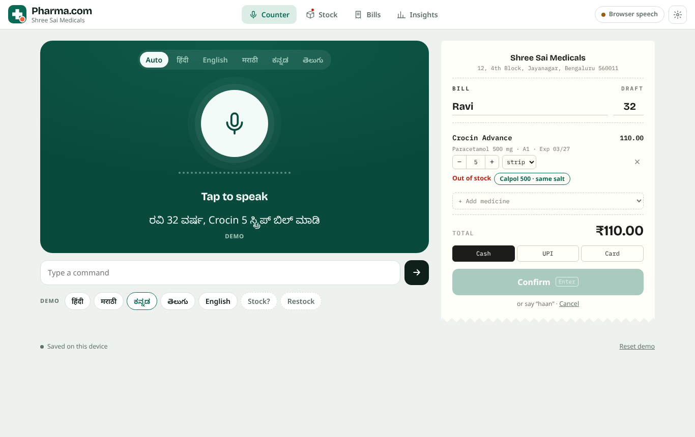

# Pharma.com

**Goli bolo, bill lo.** Say the tablets, get the bill. The stock updates itself.

Pharma.com is a voice-first billing and stock app for Indian retail pharmacies. The pharmacist says one sentence, in Hindi, English, Marathi, Kannada or Telugu:

> अभिजीत, 16 साल, Dolo 650 की 10 स्ट्रिप का बिल बनाओ

Pharma.com checks stock, drafts the bill on a thermal-style slip, offers a same-salt substitute if a medicine is out of stock, confirms on “haan”, prints, and deducts stock. Manual check-and-bill takes minutes per patient. Pharma.com does it in seconds.



> **Prototype notice.** The store, medicines, prices, batches and stock are demo data. Pharma.com is not connected to any real pharmacy, distributor or payment system.

## What it does

| Area | What you get |
|---|---|
| **Counter** | Tap the mic (or press Space), speak, check the slip, confirm by voice or Enter. Live waveform and transcript. |
| **Languages** | Auto-detect, Hindi, English, Marathi, Kannada, Telugu. Mixed speech (“Pan-D 2 strip aur Cetzine 5 goli”) works. Number words in all five languages. |
| **Stock check** | “Dolo 650 स्टॉक में है क्या?” shows quantity, rack, expiry and MRP. |
| **Restock** | “Pan 40 ki 20 strip stock mein add karo” adds stock after confirmation. |
| **Expiry** | Stock sorted expiry-first (FEFO). Filter by window: 30 days, 60 days, 3 months, 6 months, 1 year, expired. Shows days left and stock value at MRP. Expired stock is blocked at billing with a same-salt alternative. |
| **Voice agent** | “Talk to agent” starts a Sarvam Samvaad voice agent (agent key + agent, org and workspace IDs in Settings). Whatever the customer or pharmacist says to the agent also drafts the bill when it names a medicine. |
| **Safety** | Out-of-stock and short-stock warnings, same-salt substitutes, Rx (Schedule H) flags, expiry-soon flags. |
| **Bills** | GST-style tax invoice with batch and expiry per line, saved with the time taken. |
| **Dashboard** | Total sales for today / 7 days / 30 days, top sellers by revenue with stock left, a “Sell first” list of stock expiring within 3 months, seconds per bill against a 5-minute manual bill, and a voice log. Ships with 28 sample bills (marked “Sample”) so the dashboard is not empty. |

## How it works

```
Mic → 16 kHz WAV → Sarvam speech-to-text (saaras:v4)  ─┐
                    Browser speech recognition (backup) ┘→ transcript
transcript → public/core.js parser (transliteration, number words, fuzzy medicine match)
          → intent: bill | stock | restock | confirm | cancel
          → bill slip → confirm → stock deducted, bill + log saved
```

- `public/core.js`: pure logic, runs in the browser and Node: the 50-medicine demo catalogue, Indic→Latin transliteration, number words, fuzzy matching, `parseCommand()`.
- `public/app.js`: UI, data, microphone, Sarvam calls, Samvaad agent, printing.
- `public/vendor/sarvam-agent.js`: Sarvam's `sarvam-conv-ai-sdk` 0.0.42 browser build (MIT), bundled as `window.SarvamConv`.
- `index.html` (root): single-file build of `public/` for GitHub Pages; regenerate with `npm run build`.
- `api/stt.js`: a Vercel Edge Function that holds `SARVAM_API_KEY` on the server, so a public link never exposes the key.
- `tests/parser.test.js`: 21 checks across all five languages (`npm test`).
- `tools/bundle.py`: builds `dist/Pharma-com.html`, a single file you can open in Chrome.

## Run it

**Quickest (laptop demo):** open `dist/Pharma-com.html` in Chrome → gear icon → paste your Sarvam API key → **Test key** → **Save**. Allow the microphone when asked.

**Public link with voice (Vercel, recommended):**
1. Push this folder to a GitHub repository named `pharma-com`.
2. On vercel.com: **Add New Project** → import `pharma-com` → Deploy.
3. **Settings → Environment Variables** → add `SARVAM_API_KEY` → **Redeploy**.
4. Open `https://<project>.vercel.app`. The pill at the top reads **Sarvam**.

**GitHub Pages (no server):** `index.html` at the repo root is the whole app in one file. Settings → Pages → Deploy from a branch → `main` / `(root)`. Pages has no server, so each tester pastes keys in the app's Settings (stored only in their browser).

Never commit the key. `.env*` is git-ignored.

## Demo script (2 minutes)

1. **Reset demo** (footer).
2. Hindi: tap the mic, say the Abhijeet line above, say “haan”. The bill prints and Dolo 650 drops by 10 strips.
3. Kannada: “ರವಿ 32 ವರ್ಷ, Crocin 5 ಸ್ಟ್ರಿಪ್ ಬಿಲ್ ಮಾಡಿ”. Crocin is out of stock, so tap **Calpol 500 · same salt**.
4. Stock check and restock with the **Stock?** and **Restock** demo chips.
5. Open **Insights** to show seconds per bill against the 5-minute manual bar.

## Roadmap

- [ ] Real backend (Postgres/Supabase) with multi-counter sync
- [ ] Barcode/batch scan alongside voice
- [ ] Prescription photo → line items
- [ ] GST returns export, distributor purchase orders from reorder alerts
- [ ] Hands-free wake word for busy counters

## Licence

MIT for the code. Medicine names are trademarks of their owners and appear only as demo catalogue entries.
